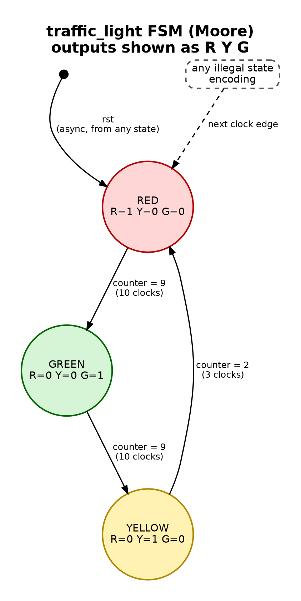

<div align = "center">

# Traffic Light Controller using Verilog

Moore FSM traffic light controller in Verilog HDL with a self-checking SystemVerilog testbench: reference-model scoreboard, reset and fault injection, coverage, and mutation testing. Simulated with Icarus Verilog.

</div>

---

## Design

Moore FSM with a cycle counter, cycling RED → GREEN → YELLOW → RED. The state register, the cycle counter, the next-state logic and the per-state terminal count are separate processes. The outputs are plain assignments from the state flops.

| State  | Duration        |
| ------ | --------------- |
| RED    | 10 Clock Cycles |
| GREEN  | 10 Clock Cycles |
| YELLOW | 3 Clock Cycles  |

* **Reset:** Asynchronous assert, active-high (`posedge rst`). Forces state to RED and counter to 0. Reset deassertion is not synchronized to `clk`.
* **Outputs:** Moore. Each light (`red`, `yellow`, `green`) is driven directly by its own state flop, so there is no output decode logic.
* **State encoding:** one-hot, `{YELLOW, GREEN, RED}` = `100`, `010`, `001`. Any other encoding is illegal and goes to RED on the next clock edge.
* **Counter:** counts `0 .. N-1` in each state and restarts on every state change. Its width is derived from the longest duration (4 bits at the defaults).
* **Parameters:** `RED_CYCLES`, `GREEN_CYCLES`, `YELLOW_CYCLES` (defaults 10 / 10 / 3).

<div align = "center" >


<p><strong>State diagram. Solid dot = reset entry into RED; dashed arrow = illegal-state recovery.</strong></p>
</div>

Diagram source: [fsm_state_diagram.dot](fsm_state_diagram.dot). Regenerate with `dot -Tpng -Gdpi=150 fsm_state_diagram.dot -o fsm_state_diagram.png` (needs Graphviz).

<details>
<summary>Diagram source (Graphviz)</summary>



</details>

---

## Files

| File                      | Description                                                                         |
| ------------------------- | ----------------------------------------------------------------------------------- |
| traffic_light.v           | Verilog RTL implementation of the Traffic Light Controller                          |
| fsm_state_diagram.dot/.png | State diagram source (Graphviz) and rendered image                                  |
| traffic_light_tb.v        | Basic testbench (prints light changes with `$monitor`; no checks, no waveform dump) |
| traffic_light_verif_tb.sv | Self-checking testbench: reference model, reset and fault injection, coverage       |
| mutate.py                 | Injects 13 known bugs into the RTL and confirms the testbench fails on each         |
| VERIFICATION_NOTES.md     | Scope, limitations, tool issues, bugs found                                         |
| Makefile                  | `make sim`, `make verify [SEED=n]`, `make mutate`, `make clean`                     |

---

## Run

Requires [Icarus Verilog](https://github.com/steveicarus/iverilog) (tested with 12.0) and `make`. `make mutate` also needs `python3`.

```
make sim              # basic testbench
make verify           # self-checking testbench (SEED=1)
make verify SEED=42   # same, different random seed
make mutate           # inject 13 bugs, expect all caught
```

`make verify` exits non-zero unless the testbench prints `RESULT: PASS`.

### Basic simulation output

<div align ="center" >

<p><strong>Output of our Traffic Controller FSM </strong></p>
</div>

### Verification output

Output of `make verify` (SEED=1, Icarus 12.0):

```
SEED=1  (reproduce with +SEED=1)

=== Coverage ===
Reset-arrival positions hit : 23 / 23
Illegal codes recovered     : 5 / 5
Async resets from non-RED   : 13
Sequence wraps observed     : 25

Total errors: 0
RESULT: PASS
```

---

## What this verifies

`traffic_light_verif_tb.sv` is self-checking. Checks use only the `red`/`yellow`/`green` pins and a reference model that tracks position `0..22` in the 23-cycle sequence; the model is a modulo counter, not a copy of the FSM.

* **Scoreboard:** on every `negedge clk`, the pins must match the model, exactly one light must be on, and no output may be X/Z. This checks the durations (10/10/3) and the RED → GREEN → YELLOW → RED order cycle by cycle.
* **Async reset:** applied mid-cycle at every one of the 23 sequence positions, with RED required immediately and no clock edge in between.
* **Clock-edge-timed reset:** reset changing on the clock edge itself, at positions 1-22.
* **Fault injection:** five illegal state encodings are forced into the state register (`force dut.state`); recovery to RED is required at the next clock edge, after which the scoreboard must keep passing.
* **Seeded random events:** 60 random events (reset pulses from 1 ns runts to several cycles, edge-timed resets, illegal-state injection). The seed is printed; reproduce a run with `SEED=n`.
* **Coverage:** bins are measured from the model, not from what the stimulus intended. Any hole fails the run. Icarus 12.0 has no `covergroup`, so the bins are counters with a printed report.
* **Mutation testing:** `make mutate` injects 13 hand-written bugs (wrong durations, skipped state, illegal-state lockup, synchronous reset, reset ignored on the terminal-count cycle, counter faults, swapped outputs) and requires the testbench to fail on each. All 13 are caught.

### Bugs found while building it

* Testbench sampling race: `rst` was driven with a blocking assignment, racing the DUT's `@(posedge clk or posedge rst)` block on the edge it changed. The symptom was an off-by-one in the RED duration check. Fixed by driving `rst` with nonblocking assignments at clock edges.
* Simulator bug mistaken for a DUT bug: Icarus Verilog 12.0 returns wrong values from `$countones`/`$onehot0` on a packed `{red, yellow, green}`, which looked like a mutual-exclusion violation. A 6-line repro is in [VERIFICATION_NOTES.md](VERIFICATION_NOTES.md). Replaced with a manual bit count.

Design weaknesses found in review and fixed in the current RTL (illegal-state lockup, output decode glitch risk, duplicated terminal-count logic, hardcoded durations) are listed in [VERIFICATION_NOTES.md](VERIFICATION_NOTES.md).

---

## Limitations

* Reset deassertion is asynchronous (no reset synchronizer). Deassertion timing relative to `clk` is not tested; RTL simulation cannot show recovery/removal violations.
* The reference model is hardcoded to the default 10 / 10 / 3 durations. The RTL is parameterized, but only the default configuration is verified.
* The testbench uses one hierarchical reference, `dut.state`, to inject illegal states. It is tied to that signal's name and 3-bit one-hot encoding.
* The scoreboard is cycle-exact. A variant with registered (one-cycle-late) outputs would fail it unless the model is shifted to match.
* The 13 mutants were chosen by the author of the testbench, so "all caught" is a floor, not proof of completeness.
* No concurrent SystemVerilog assertions and no formal proofs (Icarus 12.0 rejects `assert property`).
* Not synthesized or linted; no area or timing results.
* Single signal only, no sensor or pedestrian input.
